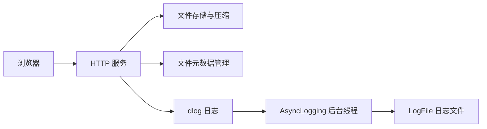

# dlog-cloud-storage 开发计划

## 1. 项目定位与第一版目标

`dlog-cloud-storage` 是基于 C++17 的轻量级云存储系统，使用 XMake 构建，集成 dlog 异步日志库，计划支持 Web 文件上传下载、普通存储和压缩存储。

按最简单可用版本推进：先完成普通文件的上传、列表、下载和重启恢复，直接使用现有 dlog；通过验收后再增加压缩存储。

参考项目为 [Kama-AsynLogSystem-CloudStorage](https://github.com/youngyangyang04/Kama-AsynLogSystem-CloudStorage)。保留 [dlog](https://github.com/DavidingPlus/dlog) 作为独立日志库，云存储项目依赖它，存储业务拥有自己的模块和测试。

本项目交付的是可执行程序，不作为公共库发布。客户端与服务端分别使用 `client`、`server` 命名空间，`main()` 保留在全局命名空间；调用 dlog 时使用它已有的接口和命名空间。

构建时将应用入口与其余源码分开：

| 构建目标 | 职责 |
| --- | --- |
| `dlog-cloud-storage-static` | 内部静态库，编译 `src/` 下除 `main.cpp` 外的源码，供主程序、单元测试和开发示例共用 |
| `dlog-cloud-storage` | 可执行程序，编译 `src/main.cpp` 并链接内部静态库 |
| `tests` | 沿用原模板的 GoogleTest 分组，链接内部静态库测试业务代码 |

内部静态库只参与项目构建，不安装到应用发布目录。对外发布可执行程序及其运行资源，公共头文件导出和 xmake-repo 库分发流程仍然不需要。

在本机启动服务，通过浏览器上传普通文件、查看文件列表、下载原文件；重启服务后仍能查看和下载此前上传的文件。上传、下载、错误和正常关闭过程使用现有 dlog 记录日志。

默认先在当前 Windows 环境跑通，再验证 Linux。开发期间绑定 `127.0.0.1`，使用本地浏览器即可验证。

## 2. 参考文档与依赖

参考文档目录：`D:\Workspace\study-notes\为了工作\Cpp\代码随想录\C++\基于异步日志系统的云存储服务`。

| 文档 | 本项目使用方式 |
| --- | --- |
| `2.环境准备.md` | 了解 libevent、JsonCpp、bundle 的用途；在本项目中使用 XMake 管理构建依赖 |
| `3.让项目跑起来.md` | 对照浏览器上传、列表、下载，以及服务端数据目录的最终行为 |
| `4.基础日志系统讲解.md`、`5.框架梳理.md` 的日志部分 | 理解日志接入位置，复用 dlog 的已有实现 |
| `5.框架梳理.md` 的存储部分 | 重点参考 Config、Util、DataManager、Service 和页面之间的调用关系 |
| `8.后续优化.md` | 普通存储完成后，再选择需要的扩展 |
| `【补充】客户端扩展.md` | 后续需要自动扫描和上传客户端文件时再实施 |

HTTP 服务和 JSON 处理默认沿用参考项目的 libevent、JsonCpp。压缩阶段再验证参考项目使用的 bundle 及 LZIP 格式。依赖版本以实际安装、编译和运行验证的结果为准。

资料：[libevent HTTP 服务说明](https://libevent.org/libevent-book/Ref10_http_server.html)、[JsonCpp](https://github.com/open-source-parsers/jsoncpp)、[bundle](https://github.com/r-lyeh-archived/bundle)。

## 3. 系统结构、模块与数据约定



上传的文件由存储模块保存；dlog 记录上传、下载、压缩过程中的状态、耗时和错误。

沿用参考项目的存储语义：**未压缩存储直接保存文件，压缩存储先压缩再保存文件**，存储类型由上传请求指定。参考项目分别称为“浅度存储”和“深度存储”，本项目使用 `uncompressed` 和 `compressed` 明确表示文件是否经过服务端压缩。两个文件目录的配置键分别为 `uncompressed_files_dir` 和 `compressed_files_dir`。[参考上传与下载实现](https://github.com/youngyangyang04/Kama-AsynLogSystem-CloudStorage/blob/main/src/server/Service.hpp)

模块按需逐步创建，以下位置和接口均为实施建议。

| 建议位置 | 职责 |
| --- | --- |
| `src/main.cpp` | 按顺序初始化配置、日志、元数据和服务；完成退出清理 |
| `src/core/applogging.h/.cpp` | 封装应用侧 `InitLogging()`、`ShutdownLogging()`，管理异步后端的生命周期 |
| `src/core/appconfig.h/.cpp` | 保存并加载服务地址、端口、数据目录、日志路径和文件大小限制 |
| `src/storage/fileops.h/.cpp` | 创建目录、校验文件名、二进制读写、处理本次上传的临时文件 |
| `src/storage/storageinfo.h` | 定义一份文件元数据 |
| `src/storage/datamanager.h/.cpp` | 内存查询、JSON 持久化和启动恢复 |
| `src/http/service.h/.cpp` | libevent 生命周期、路由和请求处理 |
| `web/index.html` | 文件选择、上传、列表和下载链接 |
| `config/storage.json` | 运行配置，区别于 XMake 生成的编译配置头文件 |

第一版使用单个 HTTP 事件循环，在 HTTP 回调中同步完成文件处理。这样元数据操作可以先使用普通容器；后续引入业务工作线程时，再统一设计锁和请求生命周期。

最小文件元数据建议为：

| 字段 | 约定 |
| --- | --- |
| `filename` | 经校验的原始文件名，作为第一版的查询键 |
| `storageType` | `normal`；压缩阶段再增加 `compressed` |
| `filePath` | 服务端生成的、相对于数据根目录的存储路径 |
| `originalSize` | 原文件字节数，使用 64 位无符号整数 |

下载 URL 根据文件名生成，不必重复持久化。访问时间、修改时间等字段可以在有实际用途时增加。

第一版同名上传返回冲突，保留已有文件。名称判断还要考虑当前文件系统的大小写规则。文件名只能表示一个文件，拒绝目录分隔符、绝对路径、`.`、`..`、控制字符及当前平台不支持的名称。文件路径统一由服务端拼接。

## 4. dlog 能力与接入生命周期

dlog 已具备日志格式化、多线程追加、异步写盘、文件轮转，以及正常停止时排空缓冲区的能力，可以承担本项目的日志基础。主要分工如下：

| 组件 | 职责 |
| --- | --- |
| `Logger` / `LogStream` | 拼接日志元数据和正文，通过输出回调交给后端 |
| `AsyncLogging` | 接收并发追加的日志，在后台线程中批量写入 |
| `LogFile` | 管理日志文件、刷新和轮转 |

相关资料：[dlog 说明与示例](https://github.com/DavidingPlus/dlog/blob/master/README.md)、[异步后端实现](https://github.com/DavidingPlus/dlog/blob/master/src/core/asynclogging.cpp)。

当前保持 dlog 原状，先推进存储部分。下面的日志配置属于应用侧接入，遇到具体需求时再考虑修改日志库。

### 启动与运行

1. 创建并启动 `dlog::AsyncLogging`，配置日志路径、轮转大小和刷新间隔。
2. 在业务线程启动前，通过 `dlog::Logger::SetOutput()` 将格式化后的日志交给异步后端的 `append()`。
3. 文件日志使用 `dlog::LogLevelColorMode::OFF`，避免写入终端颜色控制序列。
4. 业务代码继续使用 dlog 的函数式日志宏，例如：

```cpp
DLOG_INFO() << "upload finished, file=" << filename
            << ", size=" << fileSize;
```

输出回调接收的是“起始地址 + 有效长度”的字节序列，应按原始长度传给后端，不按以空字符结尾的字符串处理。输出和刷新回调是进程内共享配置，设置与切换时需要保证没有并发日志调用。[Logger 接口](https://github.com/DavidingPlus/dlog/blob/master/src/core/logger.h)

### 正常关闭

1. 停止接收新请求，并等待请求处理线程和其他产生日志的业务任务结束。
2. 完成业务资源清理，写出最后的关闭日志。
3. 将输出和刷新回调切换为不引用异步后端的有效回调。
4. 调用异步后端的 `stop()`，排空待写队列和未写满的缓冲区，等待后台线程退出，再销毁后端。

关闭顺序需要保证异步后端停止后不再向它追加日志，也不会通过回调访问已经销毁的后端。[异步后端实现](https://github.com/DavidingPlus/dlog/blob/master/src/core/asynclogging.cpp)

## 5. 第一版 HTTP 协议

以下协议保留参考项目的上传、下载和展示功能，具体字段是本项目的新约定。

| 方法与路径 | 请求和响应 |
| --- | --- |
| `GET /` | 返回页面 |
| `POST /upload?name=<URL编码的文件名>&type=normal` | 请求体为原始文件字节，类型为 `application/octet-stream`；成功返回 201 和结果 JSON |
| `GET /files` | 返回文件列表 JSON |
| `GET /download/<URL编码的文件名>` | 返回原文件内容，成功状态为 200 |

失败使用 400（参数、文件名或类型无效）、404（文件或路径不存在）、405（方法不支持）、409（同名冲突）、413（文件过大）、500（内部读写失败）。第一版只接受 `type=normal`，压缩功能完成后再接受 `type=compressed`。

## 6. 分阶段实施

### 6.1 第一阶段：普通存储

#### 第 1 步：接入 dlog

1. 注册已确认可用的自有 XMake 包仓库，将 dlog 加入当前 `package_dependencies.common`。
2. 在应用侧封装 `InitLogging()`、`ShutdownLogging()`，按第 4 节管理异步后端、输出回调和退出顺序。
3. 普通错误使用 `DLOG_ERROR()`；需要退出时由应用执行正常清理。

验收：构建、运行主目标；日志文件中有启动、普通消息和关闭消息，最后一条日志在正常退出后仍存在。

#### 第 2 步：运行一个最小 HTTP 服务

1. 将 libevent 加入 XMake 依赖。
2. 实现事件环境创建、HTTP 对象创建、监听、回调注册、事件循环和资源释放。
3. 先让 `GET /` 返回一段固定文本，未知路径返回 404。
4. 提供能够退出事件循环并回到 `main()` 清理的正常停止方式；初始化失败时释放已创建的资源。

验收：访问 `http://127.0.0.1:8081/` 能获得响应；停止服务后有完整的关闭日志。

#### 第 3 步：配置与文件工具

1. 加入 JsonCpp，定义 `AppConfig`；读取 `config/storage.json`，设置可用默认值。
2. 配置服务地址、端口、数据根目录、元数据文件、页面路径、日志路径和上传大小限制。
3. 业务文件的相对路径统一以可执行文件所在目录为基准；创建所需目录。
4. 实现二进制读写和文件名校验。先限制小文件，例如最大 16 MiB，允许合法的零字节文件。

验收：修改端口和目录可以生效；包含零字节的二进制文件读写后内容一致；非法文件名被拒绝；合法中文、空格、加号文件名能在当前平台处理。

#### 第 4 步：元数据与本地存储闭环

1. 定义 `FileMetadata`，实现内存中的按名称查询和列表查询。
2. 实现 JSON 加载和保存；首次运行没有元数据文件时使用空列表，文件格式错误时报告错误。
3. 在本地调用中跑通“保存普通文件 → 持久化元数据 → 查询 → 读取文件”。
4. 上传成功的条件是文件保存和元数据保存都成功；元数据保存失败时，不发布成功条目，清理本次新建文件。

当前阶段继续采用参考实现的持久化模型：启动时全量加载 JSON 元数据到内存表，运行时查询内存表，插入或更新后同步保存整张表。按需读取和增量持久化列入[元数据存储优化](#元数据存储优化)，后续再评估。

元数据先写临时文件，成功后替换正式文件，再更新内存状态。Windows 和 Linux 的文件替换方式需分别确认；失败时保留上一份正式元数据。这里处理的是正常运行中的失败，第一版不承诺突然断电时的事务恢复。

验收：重建 `DataManager` 后仍能查到文件，读取结果与原文件一致；同名写入被拒绝，原数据保持有效。

#### 第 5 步：接入 HTTP 上传

1. 使用第 5 节约定的 `POST /upload`，解析文件名、存储类型和二进制请求体。
2. 校验参数、文件名、大小限制和同名冲突。
3. 调用文件工具和元数据管理，全部成功后返回上传成功。
4. 日志记录文件名、大小、结果和错误原因，正文保持简短。

验收：先用 HTTP 工具上传文本和二进制文件；磁盘内容一致，元数据正确；失败响应不会出现成功条目。

#### 第 6 步：列表与下载

1. `GET /files` 返回文件列表 JSON，包含名称、原始大小、存储类型和下载 URL。
2. `GET /download/<编码后的文件名>` 根据元数据定位文件，并返回原始二进制内容。
3. 路径中的名称按 URL 路径规则解码一次，正确保留加号；使用服务端记录的路径查找文件。
4. 设置合适的响应类型和下载文件名；文件不存在时返回 404。

第一版针对受大小限制的文件，可以先读入内存再返回。流式传输和 Range 下载在后续实施。

验收：下载内容与上传内容逐字节一致；中文、空格、加号文件名的链接可用；未知文件返回 404。

#### 第 7 步：浏览器页面

1. `GET /` 返回 `web/index.html`。
2. 页面只提供文件选择、上传按钮、文件列表和下载链接。
3. 浏览器以文件对象作为请求体，用 `fetch()` 上传；文件名用 `encodeURIComponent()` 放入查询参数。
4. 上传成功后重新请求列表；页面显示服务端返回的错误。文件名按文本渲染，使用同源相对 URL。

这份上传协议用于减少第一版的解析代码，前后端一起实现；暂不使用需要另外解析的 multipart 表单。

验收：只通过浏览器就能完成选择文件、上传、刷新列表、点击下载。

#### 第 8 步：第一版整体验收

| 场景 | 应达到的结果 |
| --- | --- |
| 首次启动 | 创建所需目录，显示空列表 |
| 文本、二进制和零字节文件 | 上传后可下载，字节内容一致 |
| 中文、空格、加号文件名 | 上传、列表、下载都可用 |
| 同名文件 | 返回冲突，已有内容不被覆盖 |
| 参数或文件名错误、文件过大 | 返回明确失败，未发布成功条目 |
| 文件或元数据写入失败 | 返回失败并记录错误，原有条目仍可用 |
| 正常停止并重启 | 文件和列表恢复，之前的文件仍可下载 |
| 正常停止 | 最后一批业务和关闭日志已写出 |

业务测试先沿用现有 `test/core` 分组，覆盖文件内容往返、同名保护、元数据恢复和失败后的状态；再做一次真实 HTTP 和浏览器验证。

在项目根目录使用现有目标构建、运行；启用 GoogleTest 后运行对应测试分组：

```powershell
xmake build -y dlog-cloud-storage
xmake run dlog-cloud-storage
xmake test -y tests/core
```

这些是实施时的验证步骤，本计划仅描述实施路线，尚未执行功能开发和集成测试。

### 6.2 第二阶段：压缩存储

普通存储验收通过后，再补齐参考项目的另一种核心存储方式。

1. 先独立验证压缩库的构建及“原数据 → 压缩 → 解压 → 原数据”往返结果；沿用参考项目时采用 bundle 的 LZIP 格式。
2. 在文件工具中封装压缩、解压接口，给配置增加压缩文件目录。
3. 上传仍接收普通文件；选择 `compressed` 时，由服务端压缩后保存，元数据保留原始大小和实际路径。
4. 下载时根据元数据解压并返回原始内容；对第一版小文件可以先在内存中解压，避免共享临时下载文件。
5. 页面增加“普通存储 / 压缩存储”的选择，沿用已有列表和下载接口。
6. 验证压缩失败、数据损坏和重启恢复；失败时不发布成功条目，解压后内容与上传内容一致。

## 7. 后续扩展与实施注意事项

以下扩展按实际需求独立实施，不作为最小版本的完成条件。新增能力分别验证对应行为。

- 断点下载、删除、客户端自动同步、多用户。
- 重要日志备份、FATAL 刷新、等级过滤和积压控制。
- 并发处理、进一步故障验证及安装、发布流程。

### 元数据存储优化

2026-10-20 的实施取舍：当前先按参考实现完成 `DataManager`，采用内存元数据表与 JSON 全量保存，后续再评估按需读取方案。

计划采用的流程为：

1. 启动时由 `loadFromDisk()` 读取整个元数据文件，恢复 `m_table`。
2. 运行期间通过 `m_table` 查询和修改记录。
3. 插入或更新后调用 `persistToDisk()`，把整张表序列化为 JSON，并覆盖保存元数据文件。

接口约定：`insert(info)` 只新增记录，URL 已存在时抛出 `std::invalid_argument`；`update(info)` 只更新已有记录，URL 不存在时抛出 `std::out_of_range`。两者修改后都持久化，保存失败时传播异常。私有函数 `insertWithoutPersist(info)` 只向内存表新增记录，URL 重复时同样报错，供 `loadFromDisk()` 加载历史元数据时调用。

路径约定：配置文件、存储文件和元数据持久化文件的相对路径都以可执行文件所在目录为基准，绝对路径按原路径访问。`config/server.conf` 通过 `compressed_files_dir`、`uncompressed_files_dir` 和 `metadata_file` 提供相对路径，`Config` 构造时通过 `readConfig()` 将它们解析为绝对路径，再次读取配置时沿用相同规则。`FileMetadata::FromFile()` 始终保存解析后的绝对路径；持久化字段 `absolute_file_path` 保存文件绝对路径，`loadFromDisk()` 直接恢复。`insert()`、`update()` 按 `FileMetadata` 已保存绝对路径的约定使用元数据。`DataManager` 构造时直接保存 `Config::getMetadataFilePath()` 返回的绝对路径，加载和保存使用同一路径，不受工作目录变化影响。

`Config` 中的三个文件系统路径、`FileMetadata::m_absoluteFilePath`、`DataManager::m_metadataFilePath` 和相关路径入参统一使用 `std::filesystem::path`。服务端固定运行于 Linux，文件名和 JSON 路径统一约定使用 UTF-8；读入时直接将字符串赋给 `path`，写出时调用 `string()`。`getOneByFilePath()` 将查询路径按可执行文件目录解析为绝对路径后，直接与记录中的绝对路径比较。暂不处理 `.`、`..` 等写法差异。该查询不要求实际文件存在，也不解析符号链接。

这套流程处理的是文件元数据，上传文件的实际内容仍通过各自的存储路径读写。它便于理解和实现，但内存占用随记录数量增长，每次修改也需要序列化和写入全部记录。后续结合元数据数量、修改频率、加载耗时、内存占用和保存耗时决定是否调整。

| 候选方案 | 读写方式 | 需要处理的内容 |
| --- | --- | --- |
| SQLite | 通过索引按需查询记录，通过事务插入和更新 | 引入数据库依赖，为 URL 和存储路径建立索引，调整初始化和保存职责 |
| 内存表与追加日志 | 继续查询内存表，每次追加变更，定期合并为完整快照 | 实现启动重放、未完成记录的处理及日志合并；仍需将元数据加载到内存 |

SQLite 已提供磁盘索引、页缓存和事务管理，可作为按需读取的优先评估方案。[SQLite 架构](https://www.sqlite.org/arch.html)、[索引查询说明](https://www.sqlite.org/queryplanner.html)

直接在每次查询时打开普通 JSON 文件查找记录，可能仍需扫描整个文件；高效按需读取需要配合索引。当前 `getAll()` 返回全部记录的 vector，若列表也需要按需读取，后续应增加分页查询接口。

### 重要日志备份与 FATAL 刷新

参考项目对 ERROR/FATAL 日志有备份逻辑。远程备份列入后续扩展，需要时再确定备份位置、触发方式和失败处理。[参考日志实现](https://github.com/youngyangyang04/Kama-AsynLogSystem-CloudStorage/blob/main/log_system/logs_code/AsyncLogger.hpp)

dlog 的 `DLOG_FATAL()` 在输出后调用刷新回调，再终止进程；默认刷新回调只刷新标准输出。仅接入异步输出回调，不能保证 FATAL 日志在进程终止前写入文件。最小版本普通错误使用 `DLOG_ERROR()` 并返回失败，需要结束服务时执行正常清理。后续需要 FATAL 保障时，再设计同步刷新或备份机制，并通过独立进程验证终止前的日志结果。[Logger 实现](https://github.com/DavidingPlus/dlog/blob/master/src/core/logger.cpp)

### 跨平台适配

参考项目使用 `pthread`、POSIX 文件接口和 Linux Makefile。本项目沿用 C++17/XMake，优先使用标准库处理文件系统、线程和锁，对必须依赖平台的操作单独封装，并验证 Windows、Linux 的构建与运行。[参考构建文件](https://github.com/youngyangyang04/Kama-AsynLogSystem-CloudStorage/blob/main/src/server/Makefile)

### 断点下载

参考项目的下载逻辑根据 `If-Range` 决定是否返回 `206`，但仍发送完整文件，没有解析 `Range` 并按指定区间发送数据。最小版本提供完整文件下载并返回 `200`。后续实现断点下载时，再补齐区间校验、部分响应、响应头以及不可满足范围的处理；涉及压缩文件时，范围应对应用户下载的原始文件内容。[参考下载实现](https://github.com/youngyangyang04/Kama-AsynLogSystem-CloudStorage/blob/main/src/server/Service.hpp)

### 日志积压与并发故障

后续需要明确后台写盘跟不上日志生产速度时的容量限制和处理策略，并验证并发上传下载、压缩失败、文件或元数据写入失败等场景中的数据状态和错误日志。

## 8. 当前状态与下一步

当前仓库已调整为“内部静态库 + 可执行程序 + 单元测试”的 XMake 应用工程，沿用原模板的 `LTest`、GoogleTest 分组和开发示例来验证链接关系。主目标为 `dlog-cloud-storage`，内部库为 `dlog-cloud-storage-static`；对外的头文件导出、DLL 接口、包元数据及 xmake-repo 更新流程已移除，尚未实现云存储业务。

当前包依赖清单为空，`main.cpp` 仍为 `LTest` 示例。上述业务模块、HTTP 协议和页面均待实现，尚未进行云存储与 dlog 的集成运行验证。

本计划于 2026-10-13 整理，2026-10-14 根据最简单可用版本的要求及本地参考文档更新，并合并具体实施路线。实现时应再次核对所采用依赖版本的接口和行为，Windows、Linux 的构建与运行在所交付版本上验证。

从第 1 步完成应用侧 dlog 接入，再按顺序推进存储内容。每一步完成对应验收后再进入下一步；第 8 步通过作为普通存储版本完成的标准。

