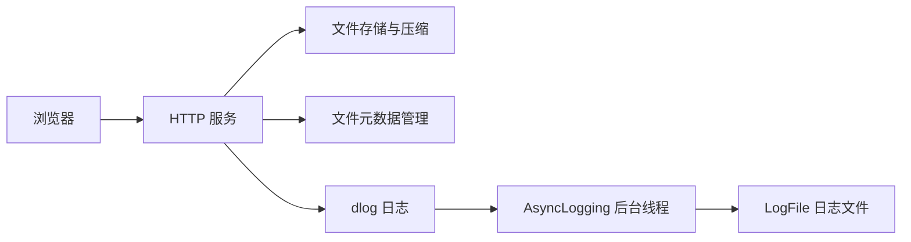

# dlog-cloud-storage 开发计划

## 1. 项目定位

`dlog-cloud-storage` 是基于 C++17 的轻量级云存储系统，使用 XMake 构建，集成 dlog 异步日志库，计划支持 Web 文件上传下载、普通存储和压缩存储。

参考项目为 [Kama-AsynLogSystem-CloudStorage](https://github.com/youngyangyang04/Kama-AsynLogSystem-CloudStorage)。保留 [dlog](https://github.com/DavidingPlus/dlog) 作为独立日志库，云存储项目依赖它，存储业务拥有自己的模块和测试。

本项目交付的是可执行程序，不作为公共库发布。代码按业务模块组织，目前不专门引入统一的 `storage` 命名空间；调用 dlog 时使用它已有的接口和命名空间。

## 2. 可复用的日志能力

dlog 已具备日志格式化、多线程追加、异步写盘、文件轮转，以及正常停止时排空缓冲区的能力，可以承担本项目的日志基础。主要分工如下：

| 组件 | 职责 |
| --- | --- |
| `Logger` / `LogStream` | 拼接日志元数据和正文，通过输出回调交给后端 |
| `AsyncLogging` | 接收并发追加的日志，在后台线程中批量写入 |
| `LogFile` | 管理日志文件、刷新和轮转 |

相关资料：[dlog 说明与示例](https://github.com/DavidingPlus/dlog/blob/master/README.md)、[异步后端实现](https://github.com/DavidingPlus/dlog/blob/master/src/core/asynclogging.cpp)。

## 3. 系统结构与业务模块



上传的文件由存储模块保存；dlog 记录上传、下载、压缩过程中的状态、耗时和错误。

| 模块 | 计划实现内容 |
| --- | --- |
| HTTP 服务 | 接收上传、提供下载、返回文件列表 |
| 文件存储 | 保存文件、处理同名文件、校验存储路径 |
| 深度存储 | 上传时压缩，下载时解压 |
| 元数据管理 | 保存文件名、原始大小、存储类型、实际路径等，重启后恢复 |
| Web 页面 | 选择文件和存储类型，展示列表和下载入口 |

沿用参考项目的存储语义：**浅度存储（普通存储）直接保存文件，深度存储压缩后保存文件**，存储类型由上传请求指定。这里的“深度”指压缩存储，不涉及远端对象存储或自动冷热分层。[参考上传与下载实现](https://github.com/youngyangyang04/Kama-AsynLogSystem-CloudStorage/blob/main/src/server/Service.hpp)

HTTP 库、压缩库和元数据持久化方案在具体模块设计时确定，本计划暂不固定选型。

## 4. dlog 接入与生命周期

### 启动与运行

1. 创建并启动 `dlog::AsyncLogging`，配置日志路径、轮转大小和刷新间隔。
2. 在业务线程启动前，通过 `dlog::Logger::SetOutput()` 将格式化后的日志交给异步后端的 `append()`。
3. 文件日志使用 `dlog::LogLevelColorMode::OFF`，避免写入终端颜色控制序列。
4. 业务代码继续使用 dlog 的函数式日志宏，例如：

```cpp
DLOG_INFO() << "upload finished, file=" << filename
            << ", size=" << fileSize;
```

输出回调接收的是“起始地址 + 有效长度”的字节序列，应按原始长度传给后端，不按以空字符结尾的字符串处理。输出和刷新回调是进程内共享配置，设置与切换时需要保证没有并发日志调用。[Logger 接口](https://github.com/DavidingPlus/dlog/blob/master/src/core/logger.h)

### 正常关闭

1. 停止接收新请求，并等待请求处理线程和其他产生日志的业务任务结束。
2. 完成业务资源清理，写出最后的关闭日志。
3. 将输出和刷新回调切换为不引用异步后端的有效回调。
4. 调用异步后端的 `stop()`，排空待写队列和未写满的缓冲区，等待后台线程退出，再销毁后端。

关闭顺序需要保证异步后端停止后不再向它追加日志，也不会通过回调访问已经销毁的后端。[异步后端实现](https://github.com/DavidingPlus/dlog/blob/master/src/core/asynclogging.cpp)

## 5. 需要单独设计的事项

### 重要日志备份与 FATAL 刷新

参考项目对 ERROR/FATAL 日志有备份逻辑。本项目需要确定重要日志的备份位置、触发方式和失败处理。[参考日志实现](https://github.com/youngyangyang04/Kama-AsynLogSystem-CloudStorage/blob/main/log_system/logs_code/AsyncLogger.hpp)

dlog 的 `DLOG_FATAL()` 在输出后调用刷新回调，再终止进程；默认刷新回调只刷新标准输出。仅接入异步输出回调，不能保证 FATAL 日志在进程终止前写入文件。当前 `AsyncLogging` 没有公开的同步刷新接口，需要另行设计刷新或同步备份机制，并通过独立进程验证终止前的日志结果。[Logger 实现](https://github.com/DavidingPlus/dlog/blob/master/src/core/logger.cpp)

### 跨平台适配

参考项目使用 `pthread`、POSIX 文件接口和 Linux Makefile。本项目沿用 C++17/XMake，优先使用标准库处理文件系统、线程和锁，对必须依赖平台的操作单独封装，并验证 Windows、Linux 的构建与运行。[参考构建文件](https://github.com/youngyangyang04/Kama-AsynLogSystem-CloudStorage/blob/main/src/server/Makefile)

### 断点下载

参考项目的下载逻辑根据 `If-Range` 决定是否返回 `206`，但仍发送完整文件，没有解析 `Range` 并按指定区间发送数据。本项目需要实现实际的范围请求处理，包括区间校验、部分响应、响应头以及不可满足范围的处理；涉及压缩文件时，范围应对应用户下载的原始文件内容。[参考下载实现](https://github.com/youngyangyang04/Kama-AsynLogSystem-CloudStorage/blob/main/src/server/Service.hpp)

### 日志积压与并发故障

后续需要明确后台写盘跟不上日志生产速度时的容量限制和处理策略，并验证并发上传下载、压缩失败、文件或元数据写入失败等场景中的数据状态和错误日志。

## 6. 分阶段实施

### 第一阶段：跑通普通存储流程

- 将当前库项目模板调整为可执行程序工程，更新项目名称、入口和相关构建配置，按应用用途整理安装、发布流程及示例测试。
- 接入 dlog，建立启动、运行和正常关闭的日志生命周期。
- 实现普通文件上传、文件列表、下载、元数据持久化和基础 Web 页面。
- 完成同名文件处理和存储路径校验。

验证目标：通过浏览器完成上传、查看列表和下载；下载内容与上传内容一致；重启后仍能恢复文件信息；正常关闭后最后一批日志可在文件中找到。

### 第二阶段：加入压缩存储与断点下载

- 实现上传时压缩、下载时解压。
- 在上传请求、元数据和页面中明确区分普通存储与压缩存储。
- 管理解压临时文件的生命周期，处理压缩或解压失败。
- 实现正确的 `Range` 下载和相关响应语义。

验证目标：压缩存储的文件下载后与原始内容一致；范围下载返回指定字节；无效或不可满足的范围得到明确响应；临时文件在请求结束后得到清理。

### 第三阶段：完善日志保障与故障验证

- 实现重要日志备份和 FATAL 终止前的日志处理。
- 加入日志积压时的容量控制策略。
- 验证并发请求、正常关闭、异常失败及重启恢复。
- 完成 Windows、Linux 的构建、测试和部署说明。

验证目标：关键错误日志能够按约定保存；日志积压行为符合容量策略；并发和故障场景下的文件、元数据状态符合设计。

## 7. 当前状态

当前仓库仍是 XMake 库项目模板，主目标为 `dlog-cloud-storage`，包含 `LTest` 示例、可选 GoogleTest、头文件导出和库发布流程，尚未实现云存储业务。

本计划于 2026-10-13 整理，依据前期源码阅读、当前模板和 dlog 接口核对制定。dlog 可以承担日志部分，主要开发工作是云存储业务及两者的集成。上述阶段均为待实施计划，尚未进行云存储与 dlog 的集成运行验证；实现时应再次核对所采用依赖版本的接口和行为。

