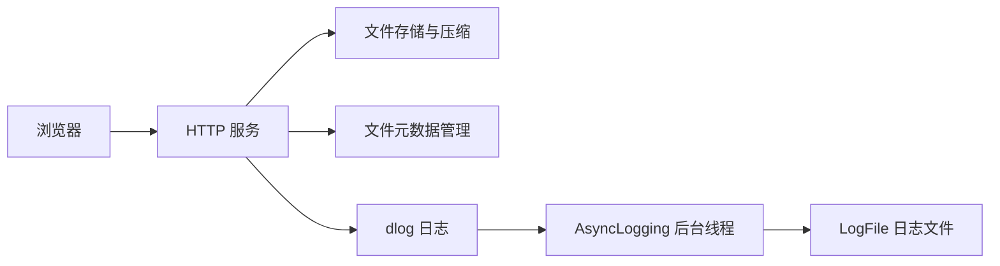

# dlog-cloud-storage 开发计划

## 1. 项目定位与第一版目标

`dlog-cloud-storage` 是基于 C++17 的轻量级云存储系统，使用 XMake 构建，集成 dlog 异步日志库，计划支持 Web 文件上传下载、普通存储和压缩存储。

按最简单可用版本推进：先完成普通文件的上传、列表、下载和重启恢复，直接使用现有 dlog；通过验收后再增加压缩存储。

参考项目为 [Kama-AsynLogSystem-CloudStorage](https://github.com/youngyangyang04/Kama-AsynLogSystem-CloudStorage)。保留 [dlog](https://github.com/DavidingPlus/dlog) 作为独立日志库，云存储项目依赖它，存储业务拥有自己的模块和测试。

本项目交付的是可执行程序，不作为公共库发布。客户端与服务端分别使用 `client`、`server` 命名空间，`main()` 保留在全局命名空间；调用 dlog 时使用它已有的接口和命名空间。

构建时将应用入口与其余源码分开：

| 构建目标 | 职责 |
| --- | --- |
| `dlog-cloud-storage-utils-static` | 内部工具静态库，编译 `src/utils/`，供 Windows、Linux 的单元测试和开发示例共用 |
| `dlog-cloud-storage-server-static` | Linux 服务端内部静态库，编译 `src/server/` 下除 `main.cpp` 外的源码，并依赖工具静态库 |
| `dlog-cloud-storage-server` | Linux 服务端可执行程序，编译 `src/server/main.cpp` 并链接服务端静态库 |
| `tests` | 沿用现有 GoogleTest 分组，Linux 下链接服务端静态库测试业务代码 |

内部静态库只参与项目构建，不安装到应用发布目录。对外发布可执行程序及其运行资源，公共头文件导出和 xmake-repo 库分发流程仍然不需要。

在本机启动服务，通过浏览器上传普通文件、查看文件列表、下载原文件；重启服务后仍能查看和下载此前上传的文件。上传、下载、错误和正常关闭过程使用现有 dlog 记录日志。

服务端固定运行于 Linux，通用工具继续支持 Windows 和 Linux。开发期间绑定 `127.0.0.1`，使用本地浏览器即可验证。

## 2. 参考文档与依赖

参考文档目录：`D:\Workspace\study-notes\为了工作\Cpp\代码随想录\C++\基于异步日志系统的云存储服务`。

| 文档 | 本项目使用方式 |
| --- | --- |
| `2.环境准备.md` | 了解 libevent、JsonCpp、bundle 的用途；在本项目中使用 XMake 管理构建依赖 |
| `3.让项目跑起来.md` | 对照浏览器上传、列表、下载，以及服务端数据目录的最终行为 |
| `4.基础日志系统讲解.md`、`5.框架梳理.md` 的日志部分 | 理解日志接入位置，复用 dlog 的已有实现 |
| `5.框架梳理.md` 的存储部分 | 重点参考 Config、Util、DataManager、Service 和页面之间的调用关系 |
| `8.后续优化.md` | 普通存储完成后，再选择需要的扩展 |
| `【补充】客户端扩展.md` | 后续需要自动扫描和上传客户端文件时再实施 |

HTTP 服务和 JSON 处理沿用参考项目的 libevent、JsonCpp，文件名通过 cpp-base64 编解码，压缩处理使用 bundle。当前已引入 JsonCpp、bundle 和 cpp-base64，libevent 与 dlog 的应用侧接入待完成。压缩阶段再验证通过 HTTP 上传、压缩、下载解压的完整流程。依赖版本以实际安装、编译和运行验证的结果为准。

资料：[libevent HTTP 服务说明](https://libevent.org/libevent-book/Ref10_http_server.html)、[JsonCpp](https://github.com/open-source-parsers/jsoncpp)、[bundle](https://github.com/r-lyeh-archived/bundle)。

## 3. 系统结构、模块与数据约定



上传的文件由存储模块保存；dlog 记录上传、下载、压缩过程中的状态、耗时和错误。

沿用参考项目的存储语义：**未压缩存储直接保存文件，压缩存储由服务端压缩处理后保存文件**。客户端通过 `StorageType` 请求头选择存储策略，本项目统一使用 `uncompressed` 和 `compressed`，分别对应配置中的 `uncompressed_files_dir` 和 `compressed_files_dir`。参考项目使用的 `low`、`deep` 取值由上述明确语义的取值替代。[参考上传与下载实现](https://github.com/youngyangyang04/Kama-AsynLogSystem-CloudStorage/blob/main/src/server/Service.hpp)

两种存储方式的上传请求体都为原始文件字节；压缩格式由服务端配置 `bundle_format` 决定，下载统一返回原始内容。

模块按需逐步创建，以下位置和接口均为实施建议。

| 建议位置 | 职责 |
| --- | --- |
| `src/server/main.cpp` | 按顺序初始化配置、日志、数据目录、元数据和服务；完成退出清理 |
| `src/server/applogging.h/.cpp` | 按需封装应用侧 `InitLogging()`、`ShutdownLogging()`，管理异步后端的生命周期 |
| `src/server/config.h/.cpp` | 已实现服务地址、端口、下载前缀、文件目录、元数据路径和压缩格式配置 |
| `src/utils/fileutil.h/.cpp`、`src/utils/common.h/.cpp` | 已实现路径定位、二进制读写、目录操作、压缩解压、URL 编解码与 HTML 文本转义；文件名校验等按需补充 |
| `src/server/datamanager.h/.cpp` | 已实现 `FileMetadata`、内存查询、JSON 持久化和启动恢复 |
| `src/server/service.h/.cpp` | 待实现 libevent 生命周期、路由和请求处理，以及上传存储类型枚举 |
| `src/server/web/template.html` | 服务端页面模板，包含文件选择、上传、列表和下载链接 |
| `src/server/config/server.conf` | 服务端 JSON 运行配置，区别于 XMake 生成的编译配置头文件 |

第一版使用单个 HTTP 事件循环，在 HTTP 回调中同步完成文件处理。继续使用当前 `DataManager` 的内存表和读写锁；后续引入业务工作线程时，再统一设计文件操作、持久化和请求生命周期之间的并发关系。

当前 `FileMetadata` 与 JSON 持久化字段为：

| C++ 字段 | JSON 字段 | 约定 |
| --- | --- | --- |
| `m_mtime` | `mtime` | 存储文件的修改时间，持久化文件系统时钟的原始计数 |
| `m_fileSize` | `file_size` | 实际存储文件的字节数，JSON 使用 64 位无符号整数 |
| `m_absoluteFilePath` | `absolute_file_path` | 服务端生成的文件绝对路径 |
| `m_url` | `url` | 下载前缀加原始文件名，作为内存表的唯一键 |

内部 `m_url` 保存未经过 URL 百分号编码的资源路径；生成供浏览器访问的下载链接时再编码，接收下载请求时按路径规则解码一次。列表中的文件名从存储路径提取，存储类型根据文件所属目录与配置目录的对应关系判断，不按路径中的 `low`、`deep` 等子串推断。

压缩文件的 `m_fileSize` 表示压缩处理后的磁盘文件大小，页面显示为“存储大小”。若后续需要展示原始大小，再扩展元数据并处理旧 JSON 的加载兼容。`m_mtime` 使用 `std::filesystem::file_time_type`，展示为日历时间前需要转换时钟，不能直接当作 `time_t` 传给 `std::ctime()`。

第一版同名上传返回冲突，保留已有文件。由于下载 URL 仅由前缀和文件名组成，两种存储策略之间的同名文件也视为冲突。名称判断还要考虑当前文件系统的大小写规则。文件名只能表示一个文件，拒绝目录分隔符、绝对路径、`.`、`..`、控制字符及当前平台不支持的名称。文件路径统一由服务端拼接。

## 4. dlog 能力与接入生命周期

dlog 已具备日志格式化、多线程追加、异步写盘、文件轮转，以及正常停止时排空缓冲区的能力，可以承担本项目的日志基础。主要分工如下：

| 组件 | 职责 |
| --- | --- |
| `Logger` / `LogStream` | 拼接日志元数据和正文，通过输出回调交给后端 |
| `AsyncLogging` | 接收并发追加的日志，在后台线程中批量写入 |
| `LogFile` | 管理日志文件、刷新和轮转 |

相关资料：[dlog 说明与示例](https://github.com/DavidingPlus/dlog/blob/master/README.md)、[异步后端实现](https://github.com/DavidingPlus/dlog/blob/master/src/core/asynclogging.cpp)。

当前保持 dlog 原状，先推进存储部分。下面的日志配置属于应用侧接入，遇到具体需求时再考虑修改日志库。

### 启动与运行

1. 创建并启动 `dlog::AsyncLogging`，配置日志路径、轮转大小和刷新间隔。
2. 在业务线程启动前，通过 `dlog::Logger::SetOutput()` 将格式化后的日志交给异步后端的 `append()`。
3. 文件日志使用 `dlog::LogLevelColorMode::OFF`，避免写入终端颜色控制序列。
4. 业务代码继续使用 dlog 的函数式日志宏，例如：

```cpp
DLOG_INFO() << "upload finished, file=" << filename
            << ", size=" << fileSize;
```

输出回调接收的是“起始地址 + 有效长度”的字节序列，应按原始长度传给后端，不按以空字符结尾的字符串处理。输出和刷新回调是进程内共享配置，设置与切换时需要保证没有并发日志调用。[Logger 接口](https://github.com/DavidingPlus/dlog/blob/master/src/core/logger.h)

### 正常关闭

1. 停止接收新请求，并等待请求处理线程和其他产生日志的业务任务结束。
2. 完成业务资源清理，写出最后的关闭日志。
3. 将输出和刷新回调切换为不引用异步后端的有效回调。
4. 调用异步后端的 `stop()`，排空待写队列和未写满的缓冲区，等待后台线程退出，再销毁后端。

关闭顺序需要保证异步后端停止后不再向它追加日志，也不会通过回调访问已经销毁的后端。[异步后端实现](https://github.com/DavidingPlus/dlog/blob/master/src/core/asynclogging.cpp)

## 5. 第一版 HTTP 协议

以下协议保留参考项目的上传、下载和展示功能。上传沿用参考项目的自定义请求头方式，存储类型取值统一为本项目的明确语义；列表沿用本计划的独立 JSON 接口。

| 方法与路径 | 请求和响应 |
| --- | --- |
| `GET /` | 返回页面 |
| `POST /upload` | 通过 `FileName` 和 `StorageType` 请求头传递上传参数；请求体为原始文件字节，类型为 `application/octet-stream`；成功返回 201 和结果 JSON |
| `GET /files` | 返回文件列表 JSON |
| `GET /download/<URL编码的文件名>` | 返回原文件内容，成功状态为 200 |

下载路径中的 `/download/` 是默认配置示例，实现时使用 `Config::getDownloadPrefix()`。

### 上传请求头与存储策略

| 请求头 | 约定 |
| --- | --- |
| `Content-Type` | `application/octet-stream`，请求体直接存放原始文件字节 |
| `FileName` | 必填；将原始文件名的 UTF-8 字节按标准 Base64 编码。服务端解码后校验文件名 |
| `StorageType` | 必填；取值统一使用小写，仅接受 `uncompressed` 或 `compressed` |

| `StorageType` 取值 | 服务端行为 | 对应配置 |
| --- | --- | --- |
| `uncompressed` | 直接保存原始文件字节 | `uncompressed_files_dir` |
| `compressed` | 使用配置中的 `bundle_format` 压缩处理后保存 | `compressed_files_dir` |

未压缩存储的请求结构如下，`YS50eHQ=` 是文件名 `a.txt` 的 Base64 编码；实际客户端还需按 HTTP 协议完成请求体长度等传输处理：

```http
POST /upload HTTP/1.1
Host: localhost:8081
Content-Type: application/octet-stream
FileName: YS50eHQ=
StorageType: uncompressed

<原始文件字节>
```

压缩存储只需将对应请求头改为 `StorageType: compressed`，请求体仍为原始文件字节。`StorageType` 描述服务端采用的存储策略，客户端无需预先压缩，也不指定压缩算法。bundle 对不适合压缩的内容可能保留原始字节，因此选择 `compressed` 不保证磁盘文件一定更小。

后端解析请求头后立即转换成枚举，业务逻辑按枚举分支处理：

```cpp
enum class StorageType
{
    Uncompressed,
    Compressed
};
```

`FileName` 或 `StorageType` 缺失、空值、文件名 Base64 编码非法或解码后的文件名不合法，以及未知存储类型，均返回 `400 Bad Request`。第一阶段只实现 `StorageType: uncompressed`；压缩功能完成前收到 `compressed` 时也返回 400，明确说明当前尚不支持该策略。第二阶段完成后接受两种策略。

其他失败使用 404（文件或路径不存在）、405（方法不支持）、409（同名冲突）、413（文件过大）、500（内部读写失败）。上传参数统一从请求头读取。

### Service 复现设计

在 `src/server/service.h/.cpp` 中实现 `server::Service`，复用现有配置、文件工具和元数据管理。沿用参考实现的职责划分、静态函数划分和回调参数；启动入口命名为 `void run()`，通过异常报告失败，参考项目的 `StorageInfo` 类型适配为本项目已有的 `FileMetadata`。后续接口调整另行决定。

| 建议接口 | 职责 |
| --- | --- |
| `Service()` | 无参构造，读取服务配置并构造、加载成员元数据管理器 |
| `void run()` | 按配置创建监听、注册通用回调并运行事件循环，失败时抛出异常 |
| `static GenericCallback(evhttp_request *, void *)` | 通用请求回调，解析路径并分发请求 |
| `static Upload(evhttp_request *, void *)` | 解析请求头和正文，保存文件并提交元数据 |
| `static FormatFileTime(std::filesystem::file_time_type)` | 直接接收文件修改时间，在函数内部完成日历时间转换和格式化 |
| `static GenerateFileListHtml(const std::vector<FileMetadata> &)` | 生成文件列表 HTML |
| `static FormatFileSize(uint64_t)` | 格式化文件大小 |
| `static ShowFileList(evhttp_request *, void *)` | 查询元数据并返回包含文件列表的 HTML 页面 |
| `static GetETag(const FileMetadata &)` | 根据元数据生成 ETag |
| `static Download(evhttp_request *, void *)` | 按请求路径查找元数据，读取或解压后返回原始字节 |

请求处理函数统一保留参考实现的 `(evhttp_request *, void *)` 参数，不预先拆分实例分发函数或注入 `DataManager`。`run()` 已实现事件循环和 HTTP 服务创建、配置地址与端口监听，以及通用回调注册；注册 `GenericCallback` 时以 `this` 作为上下文。资源以智能指针管理，按 HTTP 服务、事件循环的顺序自动释放；正常结束直接返回，创建事件循环或 HTTP 服务、绑定监听、运行事件循环失败时抛出 `std::runtime_error`。暂不添加信号处理，停止流程后续再补充。文件时间、文件大小、列表 HTML 和 ETag 辅助函数已实现；`GenericCallback()` 已实现请求分发，`ShowFileList()` 已实现页面响应，`Upload()`、`Download()` 仍为空实现；断点下载仍按第 7 节后续实施。

本节骨架先沿用参考实现的 `ShowFileList()` 页面生成职责；上方协议和第 6 节中的独立 `/files` 接口作为原计划保留，后续确定是否拆分时再统一调整。

`Service` 通过对象成员 `DataManager m_dataManager` 拥有元数据管理器，其生命周期随服务对象管理，构造时加载持久化文件。`ShowFileList()` 通过回调参数 `arg` 取回当前 `Service`，调用 `m_dataManager.getAll()`，读取可执行文件旁的 `web/template.html`，用 `std::regex_replace()` 替换 `{{FILE_LIST}}` 和 `{{BACKEND_URL}}`，最后写入请求的输出缓冲区，以 `text/html;charset=utf-8` 返回 HTTP 200。后端地址由配置中的 IP 和端口拼接。

`GenericCallback()` 当前按参考流程提取 URI 路径并进行 URL 解码，再依次判断：路径中包含配置下载前缀时调用 `Download()`，路径等于 `/upload` 时调用 `Upload()`，路径等于 `/` 时调用 `ShowFileList()`，其余返回 404。请求方法校验、回调异常处理和独立 `/files` 接口后续再补充。下载接入时再统一路径传递，避免对已解码的字符串重复解码。

启动阶段按“配置与日志 → 数据目录及缺失的元数据文件初始化 → 构造 `Service`（同时构造并加载成员 `DataManager`）→ `Service::run()`”组织。元数据文件必须在构造 `Service` 前准备好，缺失或加载失败会使构造抛出异常；当前 `main()` 尚未接入此启动流程。回调异常处理和服务停止流程后续再补齐，当前不额外增加类接口；退出后按第 4 节关闭日志。

TODO：后续补充 SIGINT/SIGTERM 的正常停止流程，包括停止接收新请求、在途上传/下载请求的收尾及退出事件循环；当前阶段暂不实现。

## 6. 分阶段实施

### 6.1 第一阶段：普通存储

#### 第 1 步：接入 dlog

1. 使用已注册的自有 XMake 包仓库，将 dlog 加入 `package_dependencies.linux`，供 Linux 服务端接入。
2. 在应用侧封装 `InitLogging()`、`ShutdownLogging()`，按第 4 节管理异步后端、输出回调和退出顺序。
3. 普通错误使用 `DLOG_ERROR()`；需要退出时由应用执行正常清理。

验收：构建、运行主目标；日志文件中有启动、普通消息和关闭消息，最后一条日志在正常退出后仍存在。

#### 第 2 步：运行一个最小 HTTP 服务

1. 将 libevent 加入 `package_dependencies.linux`，在 `src/server/service.h/.cpp` 中实现 `Service`。
2. 按第 5 节的职责划分实现事件环境创建、HTTP 对象创建、配置地址监听、回调注册、事件循环和资源释放。
3. 先让 `GET /` 返回一段固定文本，未知路径返回 404。
4. 提供能够退出事件循环并回到 `main()` 清理的正常停止方式；初始化失败时释放已创建的资源。

验收：访问 `http://127.0.0.1:8081/` 能获得响应；停止服务后有完整的关闭日志。

#### 第 3 步：配置与文件工具

1. 复用已实现的 `Config`、JsonCpp 和 `src/server/config/server.conf`，按现有字段校验与路径解析规则读取配置。
2. 复用服务地址、端口、下载前缀、两个存储目录、元数据文件和压缩格式；页面路径、日志路径和上传大小限制按接入需求补充。
3. 业务文件的相对路径统一以可执行文件所在目录为基准；创建所需目录。
4. 实现二进制读写和文件名校验。先限制小文件，例如最大 16 MiB，允许合法的零字节文件。

验收：修改端口和目录可以生效；包含零字节的二进制文件读写后内容一致；非法文件名被拒绝；合法中文、空格、加号文件名能在当前平台处理。

#### 第 4 步：元数据与本地存储闭环

1. 复用 `FileMetadata` 和 `DataManager` 的按 URL 查询、按文件路径查询和列表查询。
2. 复用 JSON 加载和保存；启动准备阶段创建存储目录及元数据父目录，仅在元数据文件缺失时写入 `[]`，然后构造 `DataManager`。已有文件读取或解析失败时报告错误。
3. 在本地调用中跑通“保存普通文件 → 持久化元数据 → 查询 → 读取文件”。
4. 上传成功的条件是文件保存和元数据保存都成功；元数据保存失败时，不发布成功条目，清理本次新建文件。

当前阶段继续采用参考实现的持久化模型：启动时全量加载 JSON 元数据到内存表，运行时查询内存表，插入或更新后同步保存整张表。按需读取和增量持久化列入[元数据存储优化](#元数据存储优化)，后续再评估。

元数据保存失败的回滚已实现：`insert()`、`update()` 和 `persistToDisk()` 共用写锁，保存期间不会向查询暴露中间状态。新增失败时删除刚插入的记录，更新失败时交换回旧记录，只保留单条记录的旧值。JSON 先完整写入同目录的 `metadata.json.tmp`（实际名称为配置路径加 `.tmp`），关闭后再替换正式文件；失败时清理本次临时文件并保留原 JSON。已有临时路径会报错并保留，核对清理后可重试。上传仍为空实现，后续接入时再处理上传文件本身的失败清理。

服务端运行于 Linux，需验证临时文件替换和失败清理。这里处理的是正常运行中的失败，第一版不承诺突然断电时的事务恢复。

验收：重建 `DataManager` 后仍能查到文件，读取结果与原文件一致；同名写入被拒绝，原数据保持有效。

#### 第 5 步：接入 HTTP 上传

1. 使用第 5 节约定的 `POST /upload`，读取 `FileName`、`StorageType` 请求头，将 UTF-8 文件名从 Base64 解码，将存储策略转换为 `StorageType` 枚举，并读取二进制请求体。
2. 校验必填请求头、编码、文件名、大小限制、目标路径占用和下载 URL 冲突；第一阶段只接受 `uncompressed`，允许零字节文件。请求体大小限制应同时设置在 HTTP 接收层，并在业务处理分配内存前检查实际长度。
3. 将文件保存到 `getUncompressedFilesDirPath()` 对应目录，使用最终文件路径调用 `FileMetadata::FromFile()`，插入并持久化元数据；全部成功后返回 201 和结果 JSON。
4. 日志记录文件名、大小、结果和错误原因，正文保持简短。

验收：先用 HTTP 工具上传文本、二进制和零字节文件；磁盘内容一致，元数据正确；缺失请求头、非法 Base64、未知存储类型等返回 400；失败响应不会出现成功条目。

#### 第 6 步：列表与下载

1. `GET /files` 返回文件列表 JSON，包含名称、存储大小、存储类型和下载 URL，存储类型统一返回 `uncompressed` 或 `compressed`。
2. `GET /download/<编码后的文件名>` 根据元数据定位文件，并返回原始二进制内容。
3. 路径中的名称按 URL 路径规则解码一次，正确保留加号；使用服务端记录的路径查找文件。
4. 设置合适的响应类型和下载文件名；文件不存在时返回 404。

第一版针对受大小限制的文件，可以先读入内存再返回完整内容，状态为 200。压缩文件根据所属目录判断策略，在内存中解压后返回。流式传输和 Range 下载在后续实施。

验收：下载内容与上传内容逐字节一致；中文、空格、加号文件名的链接可用；未知文件返回 404。

#### 第 7 步：浏览器页面

1. `GET /` 返回填充后的页面模板，源码位于 `src/server/web/template.html`，运行时按可执行文件目录下的 `web/template.html` 定位；XMake 配置、安装和打包时同步页面资源。
2. 页面只提供文件选择、上传按钮、文件列表和下载链接。
3. 浏览器以文件对象作为请求体，用 `fetch('/upload', ...)` 上传，设置 `Content-Type: application/octet-stream`；文件名先转为 UTF-8 字节再进行 Base64 编码，放入 `FileName` 请求头；`StorageType` 请求头先固定为 `uncompressed`。不要直接对含中文的文件名调用 `btoa(file.name)`。
4. 上传成功后重新请求列表；页面显示服务端返回的错误。文件名按文本渲染，使用同源相对 URL。

这份上传协议将上传元数据放在请求头中，正文直接使用文件字节，前后端一起实现。文件名的 Base64 编码只用于上传请求头；生成下载链接时仍使用 URL 百分号编码。

验收：只通过浏览器就能完成选择文件、上传、刷新列表、点击下载。

#### 第 8 步：第一版整体验收

| 场景 | 应达到的结果 |
| --- | --- |
| 首次启动 | 创建所需目录，显示空列表 |
| 文本、二进制和零字节文件 | 上传后可下载，字节内容一致 |
| 中文、空格、加号文件名 | 上传、列表、下载都可用 |
| `FileName` 或 `StorageType` 缺失、空值或非法 | 返回 400，未发布成功条目 |
| 同名文件 | 返回冲突，已有内容不被覆盖 |
| 参数或文件名错误、文件过大 | 返回明确失败，未发布成功条目 |
| 文件或元数据写入失败 | 返回失败并记录错误，原有条目仍可用 |
| 正常停止并重启 | 文件和列表恢复，之前的文件仍可下载 |
| 正常停止 | 最后一批业务和关闭日志已写出 |

业务测试沿用现有 `test/server` 分组，覆盖请求头解析、文件内容往返、同名保护、元数据恢复和失败后的状态；再做一次真实 HTTP 和浏览器验证。

在项目根目录使用现有目标构建、运行；启用 GoogleTest 后运行对应测试分组：

```bash
rtk xmake build -y dlog-cloud-storage-server
rtk xmake run dlog-cloud-storage-server
rtk xmake test -y tests/server
```

这些是后续实施时的验证步骤；当前基础模块已有单元测试，HTTP 功能开发和整体验收仍待完成。

### 6.2 第二阶段：压缩存储

普通存储验收通过后，再补齐参考项目的另一种核心存储方式。

1. 复用已接入的 bundle 和压缩往返测试，核对配置中的 `bundle_format`；沿用参考项目时采用 LZIP 格式。
2. 复用 `FileUtil::Compress()`、`FileUtil::UnCompress()` 和已有的压缩文件目录配置。
3. 上传请求接受 `StorageType: compressed`，正文仍为原始文件字节；由服务端压缩处理后保存到 `getCompressedFilesDirPath()` 对应目录。元数据记录实际存储路径和存储大小，若增加原始大小字段需同步处理持久化与加载兼容。
4. 下载时根据元数据解压并返回原始内容；对第一版小文件可以先在内存中解压，避免共享临时下载文件。
5. 页面增加“未压缩存储 / 压缩存储”的选择，分别发送 `StorageType: uncompressed`、`StorageType: compressed`，沿用已有列表和下载接口。
6. 验证两种策略间的同名冲突、零字节文件、压缩失败、数据损坏和重启恢复；失败时不发布成功条目，解压后内容与上传内容一致。

## 7. 后续扩展与实施注意事项

以下扩展按实际需求独立实施，不作为最小版本的完成条件。新增能力分别验证对应行为。

- 断点下载、删除、客户端自动同步、多用户。
- 重要日志备份、FATAL 刷新、等级过滤和积压控制。
- 并发处理、进一步故障验证及安装、发布流程。

### 元数据存储优化

2026-10-20 的实施取舍：当前先按参考实现完成 `DataManager`，采用内存元数据表与 JSON 全量保存，后续再评估按需读取方案。

计划采用的流程为：

1. 启动时由 `loadFromDisk()` 读取整个元数据文件，恢复 `m_table`。
2. 运行期间通过 `m_table` 查询和修改记录。
3. 插入、更新和显式保存均在写锁内，将整张表序列化到同目录临时文件，完整写入后替换正式 JSON。

接口约定：`insert(info)` 只新增记录，URL 已存在时抛出 `std::invalid_argument`；`update(info)` 只更新已有记录，URL 不存在时抛出 `std::out_of_range`。两者保存失败时恢复原有内存状态，并向调用方传播异常。私有函数 `insertWithoutPersistUnlocked(info)` 统一完成路径标准化、URL 唯一性检查和内存插入，由 `loadFromDisk()` 与 `insert()` 在持有写锁时调用，不重复加锁、不写磁盘。`insert()` 入表成功后才保存，保存失败时删除本次新增记录；重复 URL 在入表阶段直接抛出，不会误删旧记录。

当前仍沿用内存表与 JSON 全量保存模型，失败时通过撤销新增或恢复旧记录保持一致；保存过程使用私有的 `persistToDiskUnlocked()`，避免重复获取写锁。

路径约定：配置文件、存储文件和元数据持久化文件的相对路径都以可执行文件所在目录为基准。`config/server.conf` 通过 `compressed_files_dir`、`uncompressed_files_dir` 和 `metadata_file` 提供路径，`Config` 构造时通过 `readConfig()` 将相对路径解析为绝对路径，并对解析结果和显式配置的绝对路径统一调用 `lexically_normal()`，再次读取配置时沿用相同规则。`FileMetadata::FromFile()` 始终保存经过词法标准化的绝对路径；持久化字段 `absolute_file_path` 保存文件绝对路径。`insert()`、`update()` 按 `FileMetadata` 已保存绝对路径的约定接收元数据，并在入表前进行词法标准化；`loadFromDisk()` 复用 `insertWithoutPersistUnlocked()` 标准化历史记录，仅在后续持久化时才将标准化后的路径写回 JSON。`DataManager` 构造时直接保存 `Config::getMetadataFilePath()` 返回的绝对路径，加载和保存使用同一路径，不受工作目录变化影响。

`Config` 中的三个文件系统路径、`FileMetadata::m_absoluteFilePath`、`DataManager::m_metadataFilePath` 和相关路径入参统一使用 `std::filesystem::path`。服务端固定运行于 Linux，文件名和 JSON 路径统一约定使用 UTF-8；读入时将字符串赋给 `path`，写出时调用 `string()`。`getOneByFilePath()` 将查询路径按可执行文件目录解析为绝对路径，再调用 `lexically_normal()`，与记录中的标准化路径比较，支持 `.`、`..` 等写法差异。该查询不要求实际文件存在，也不解析符号链接。词法标准化仅处理路径表示；若路径中存在符号链接，消去其后的 `..` 可能改变实际访问目标。

这套流程处理的是文件元数据，上传文件的实际内容仍通过各自的存储路径读写。它便于理解和实现，但内存占用随记录数量增长，每次修改也需要序列化和写入全部记录。后续结合元数据数量、修改频率、加载耗时、内存占用和保存耗时决定是否调整。

| 候选方案 | 读写方式 | 需要处理的内容 |
| --- | --- | --- |
| SQLite | 通过索引按需查询记录，通过事务插入和更新 | 引入数据库依赖，为 URL 和存储路径建立索引，调整初始化和保存职责 |
| 内存表与追加日志 | 继续查询内存表，每次追加变更，定期合并为完整快照 | 实现启动重放、未完成记录的处理及日志合并；仍需将元数据加载到内存 |

SQLite 已提供磁盘索引、页缓存和事务管理，可作为按需读取的优先评估方案。[SQLite 架构](https://www.sqlite.org/arch.html)、[索引查询说明](https://www.sqlite.org/queryplanner.html)

直接在每次查询时打开普通 JSON 文件查找记录，可能仍需扫描整个文件；高效按需读取需要配合索引。当前 `getAll()` 返回全部记录的 vector，若列表也需要按需读取，后续应增加分页查询接口。

### 重要日志备份与 FATAL 刷新

参考项目对 ERROR/FATAL 日志有备份逻辑。远程备份列入后续扩展，需要时再确定备份位置、触发方式和失败处理。[参考日志实现](https://github.com/youngyangyang04/Kama-AsynLogSystem-CloudStorage/blob/main/log_system/logs_code/AsyncLogger.hpp)

dlog 的 `DLOG_FATAL()` 在输出后调用刷新回调，再终止进程；默认刷新回调只刷新标准输出。仅接入异步输出回调，不能保证 FATAL 日志在进程终止前写入文件。最小版本普通错误使用 `DLOG_ERROR()` 并返回失败，需要结束服务时执行正常清理。后续需要 FATAL 保障时，再设计同步刷新或备份机制，并通过独立进程验证终止前的日志结果。[Logger 实现](https://github.com/DavidingPlus/dlog/blob/master/src/core/logger.cpp)

### 跨平台适配

参考项目使用 `pthread`、POSIX 文件接口和 Linux Makefile。本项目沿用 C++17/XMake，优先使用标准库处理文件系统、线程和锁，对必须依赖平台的操作单独封装。通用工具验证 Windows、Linux 的构建与运行，服务端仅构建和验证 Linux 目标。[参考构建文件](https://github.com/youngyangyang04/Kama-AsynLogSystem-CloudStorage/blob/main/src/server/Makefile)

### 断点下载

本项目采用“文件名-文件大小-修改时间”生成自定义 ETag。强校验所需的文件更新约束、缓存清理后的处理及基础知识见 [ETag 基础知识](etag.md)。

参考项目的下载逻辑根据 `If-Range` 决定是否返回 `206`，但仍发送完整文件，没有解析 `Range` 并按指定区间发送数据。最小版本提供完整文件下载并返回 `200`。后续实现断点下载时，再补齐区间校验、部分响应、响应头以及不可满足范围的处理；涉及压缩文件时，范围应对应用户下载的原始文件内容。[参考下载实现](https://github.com/youngyangyang04/Kama-AsynLogSystem-CloudStorage/blob/main/src/server/Service.hpp)

### 日志积压与并发故障

后续需要明确后台写盘跟不上日志生产速度时的容量限制和处理策略，并验证并发上传下载、压缩失败、文件或元数据写入失败等场景中的数据状态和错误日志。

## 8. 当前状态与下一步

当前仓库采用“通用工具静态库 + Linux 服务端静态库 + 服务端可执行程序 + 单元测试”的 XMake 应用工程，服务端主目标为 `dlog-cloud-storage-server`。已有 Linux 安装与打包流程，通用工具、服务端配置和元数据管理已有实现与单元测试。

当前包依赖包括 bundle、JsonCpp 和 cpp-base64；`src/server/main.cpp` 目前只读取并输出配置。`Service`、浏览器页面和应用侧 dlog 接入仍待实现，尚未完成真实 HTTP 上传下载和集成运行验收。

2026-10-22 确认上传采用自定义请求头协议：`FileName` 传递 UTF-8 文件名的 Base64 编码，`StorageType` 使用 `uncompressed`、`compressed`。本次同步整理 Service 的职责、上传和下载流程、页面上传方式及验收要求，并校正现有目录、构建目标和基础模块状态；HTTP 功能仍属于待实施内容。

下一步先按第 6.1 节第 2 步运行最小 HTTP 服务，完成监听、固定响应、路由和停止流程，再逐步接入上传、列表、下载与浏览器页面。基础配置和工具沿用现有实现；在上传整体验收前补齐首次启动初始化、元数据持久化失败处理及应用侧 dlog 接入。第 8 步通过作为未压缩存储版本完成的标准。

